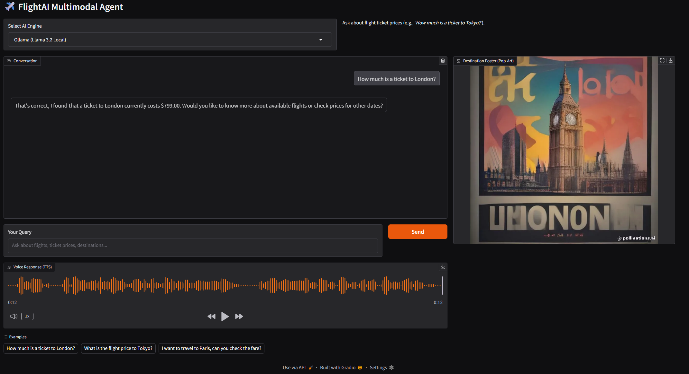

# ✈️ FlightAI: Multimodal Airline Support Agent

[](https://www.python.org/)
[](https://opensource.org/licenses/MIT)
[](https://gradio.app/)
[](https://www.docker.com/)
[](https://github.com/imehranasgari/AI-Airline-Agent/actions)

An enterprise-ready, multimodal conversational AI agent engineered for deterministic airline customer operations. The system couples large language model reasoning with strict JSON schema tool execution, verified SQLite database lookups, real-time speech synthesis (TTS), and visual artifact rendering.

---

## 🏗️ System Architecture


```
                              +-----------------------+
                              |   Gradio Reactive UI  |
                              |   (Event-Driven Web)  |
                              +-----------+-----------+
                                          |
                                          v
                              +-----------------------+
                              |  Dual Engine Router   |
                              +-----+-----------+-----+
                                    |           |
               [Cloud Inference]    |           |    [Local Privacy]
                                    v           v
                +---------------------+       +---------------------+
                | Google Gemini 2.5   |       | Local Ollama Engine |
                | (OpenAI-Compatible) |       | (Llama 3.2 3B/1B)   |
                +----------+----------+       +----------+----------+
                           |                             |
                           +--------------+--------------+
                                          |
                                          v
                          +-------------------------------+
                          |    Agentic Tool Dispatcher    |
                          |  (Function Calling Protocol)  |
                          +---------------+---------------+
                                          |
                 +------------------------+------------------------+
                 |                        |                        |
                 v                        v                        v
     +-----------------------+  +-------------------+  +---------------------+
     | Deterministic DB Tool |  |  Audio Pipeline   |  |   Vision Pipeline   |
     |  (SQLite3 Data Layer) |  |   (British TTS)   |  | (Flux via Web Scp.) |
     +-----------------------+  +-------------------+  +---------------------+
                 |                        |                        |
                 +------------------------+------------------------+
                                          |
                                          v
                              +-----------------------+
                              | Multimodal Synthesis  |
                              | (Text + Audio + Img)  |
                              +-----------------------+

```
## 📷 Screen Shot


## 🌟 Technical Highlights

- **Deterministic Tool Calling & Anti-Hallucination**: Employs an exact JSON-schema functional specification (`get_ticket_price`) to ground all pricing logic into an isolated, parameterized SQLite layer. The LLM is prohibited from guessing or fabricating flight fares.
- **Dynamic Multi-Engine Orchestration**: Dual-runtime architecture allowing on-the-fly switching between enterprise cloud models (**Google Gemini 2.5 Flash**) and private local environments (**Ollama / Llama 3.2**) via unified client abstraction.
- **Multimodal Feedback Loop**:
  - **Speech Synthesis (TTS)**: Low-latency voice generation with British English pronunciation (`gTTS` / `Edge-TTS` ready) aligned with enterprise airline personas.
  - **Generative Destination Imagery**: Automated visual artifact dispatch rendering context-driven pop-art travel graphics (Pollinations / Flux API).
- **Resilient Function Calling Loop**: Native `tool_calls` handling that parses multiple consecutive tool dispatches, serializes state-safe message histories, and eliminates model serialization drops.
- **Production-Ready MLOps Scaffold**:
  - Containerized with optimized lightweight multi-stage Docker builds (`python:3.12-slim`).
  - GitHub Actions CI pipeline running syntax verification, automated linting, and dependency consistency audits on push/PR.


## 📂 Repository Layout

```text
├── .github/
│   └── workflows/
│       └── ci.yml             # Automated CI pipeline (linting,  tests, syntax audit)
├── database.py                # Database connection pools, migrations, deterministic lookups
├── agent.py                   # Agent loop, tool definition schemas, multimodal pipelines
├── app.py                     # Gradio Blocks UI presentation layer and state callbacks
├── requirements.txt           # Production environment pinned dependencies
├── Dockerfile                 # Minimal, containerized runtime deployment spec
├── .env.example               # Environment configuration template
└── README.md                  # Comprehensive architectural and setup documentation

```

---

## 🛠️ Tech Stack & Dependencies

| Layer | Technology | Usage |
| --- | --- | --- |
| **Inference Orchestration** | OpenAI Python SDK | Standardized interface for both Gemini and local Ollama |
| **Foundational Models** | Google Gemini 2.5 Flash, Llama 3.2 | Conversational reasoning, intent parsing, tool routing |
| **Data Layer** | SQLite3 (Native Python) | Thread-safe, persistent flight ticket schema storage |
| **Voice Processing** | gTTS / BytesIO Buffers | Memory-safe, headless audio stream generation |
| **Image Processing** | Pillow (PIL), Requests | Headless rasterization and binary array image extraction |
| **User Interface** | Gradio Blocks (`>=4.0.0`) | Event-driven reactive web UI with streaming support |
| **Containerization** | Docker | Environment parity across development and deployment |

---

## 🚀 Step-by-Step Installation

### Prerequisites

* Python `3.10` to `3.12` installed.
* (Optional) [Ollama](https://ollama.ai/) installed if planning to run local inference.

### 1. Local Environment Configuration

```bash
# Clone the repository
git clone [https://github.com/imehranasgari/AI-Airline-Agent.git](https://github.com/imehranasgari/AI-Airline-Agent.git)
cd AI-Airline-Agent

# Provision virtual environment
python -m venv .venv

# Activate environment
# On Linux/macOS:
source .venv/bin/activate
# On Windows:
.venv\Scripts\activate

# Install dependencies
pip install --upgrade pip
pip install -r requirements.txt

```

### 2. Environment Variables

Create your local environment file:

```bash
cp .env.example .env

```

Populate `.env` with your API configuration:

```env
GOOGLE_API_KEY=AIzaSyYourGeneratedGeminiKeyHere

```

*(If no Google API Key is provided, the agent will seamlessly fall back to your local Ollama runtime).*

### 3. Execution

```bash
python app.py

```

Access the application dashboard at `http://127.0.0.1:7860`.

---

## 🐳 Docker Containerization

To run the agent in a fully isolated container:

```bash
# Build the production Docker image
docker build -t flightai-agent:latest .

# Run the container mapping port 7860
docker run -d \
  -p 7860:7860 \
  -e GOOGLE_API_KEY="your_api_key_here" \
  --name flightai_instance \
  flightai-agent:latest

```

The UI will be accessible on `http://localhost:7860`.

---

## 🧪 Tool Contract & Function Calling Schema

The agent operates on an explicit schema contract passed during completions, ensuring deterministic arguments:

```json
{
  "name": "get_ticket_price",
  "description": "Get the return ticket price for a destination city.",
  "parameters": {
    "type": "object",
    "properties": {
      "destination_city": {
        "type": "string",
        "description": "The destination city name in English (e.g., london, paris, tokyo)."
      }
    },
    "required": ["destination_city"],
    "additionalProperties": false
  }
}

```

---

## 👤 Author & Maintainer

**Mehran Asgari Roozbahani**

* **GitHub**: [@imehranasgari](https://github.com/imehranasgari)
* **Specialization**: Machine Learning Pipelines, MLOps, LLM Systems & Tool Integration

  
## 📄 License

This project is licensed under the [MIT License](LICENSE).
